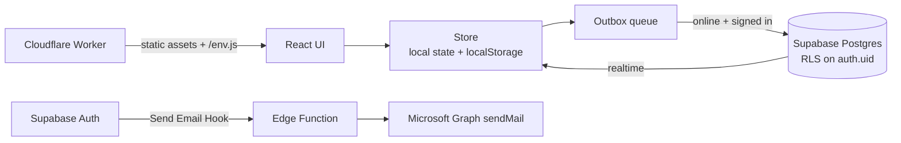

# Grand Tour

**A hotel-stay log for frequent travellers — every stay becomes a keycard.**

Grand Tour records the brand, the property, the city, the room type **as actually
stayed** (after any upgrade), the door number, what it cost — in cash or in points —
and what it earned back. It covers four loyalty programmes: Marriott Bonvoy,
Hilton Honors, ALL — Accor, and Jinjiang WeHotel.

Every stay renders as a keycard in its brand's own livery, with an embossed door
number and the property's two-letter code watermarked across the face.

**Live:** https://grandtour.cyg.world

> 中文简介：一个面向高频差旅用户的酒店入住记录应用。React 19 + TypeScript 前端，
> Supabase 云端同步（行级权限隔离），离线优先；同一套代码通过 Capacitor 打包成 Android 应用，
> 网页版部署在 Cloudflare Workers。

## Highlights

- **Offline-first sync.** Every edit lands in local state and `localStorage`
  immediately, then drains through an outbox to Supabase whenever a session and a
  network are both available. Repeated edits to one stay collapse into a single
  queued write, so the outbox stays short however long you were offline.
- **Per-user isolation in the database, not the client.** Both tables sit under
  Postgres row-level security keyed on `auth.uid()`.
- **Credentials injected at request time.** The Cloudflare Worker serves the SPA
  and generates `/env.js` on the fly, so the bundle never contains keys, a
  one-click deploy works without a `.env`, and rotating a key needs no rebuild.
- **One codebase, two targets.** The same React app ships to the web and, via
  Capacitor, as an Android APK.
- **Auth mail without SMTP passwords.** A Supabase Send Email Hook calls
  Microsoft Graph with OAuth client credentials, ahead of Exchange Online
  retiring Basic auth for SMTP ([details](supabase/functions/send-email/README.md)).
- **Design in code.** Brand liveries, guilloché patterns, foil and glass
  treatments are drawn in SVG and CSS; the About page is a colophon built
  entirely from those primitives.

## Stack

| | |
|---|---|
| Web | Vite · React 19 · TypeScript · Tailwind v4 · Motion |
| Cloud | Supabase — Postgres, email auth, row-level security, realtime · Edge Functions |
| Hosting | Cloudflare Workers + Static Assets |
| Mobile | Capacitor → Android |

## Architecture



## Running it

```bash
npm install
cp .env.example .env   # fill in your Supabase URL and publishable key
npm run dev
```

Without `.env` the app still runs, local-only, with cloud sync disabled — the
quickest way to try it.

## Deploying to Cloudflare

[](https://deploy.workers.cloudflare.com/?url=https://github.com/ERIC1148/GrandTour)

Or from a checkout:

```bash
npx wrangler login
npm run deploy
npx wrangler secret put SUPABASE_URL
npx wrangler secret put SUPABASE_ANON_KEY
```

The Worker serves the built SPA from Workers Static Assets and generates one
extra file, `/env.js`, holding those two values. The browser reads them at load
time, falling back to build-time `VITE_*` if the file is absent.

> **Gotcha worth knowing.** The Worker name in `wrangler.jsonc` must match the one
> Cloudflare's GitHub integration created from the repo name (`grandtour`). If
> they drift, `wrangler deploy` quietly creates a *second* Worker, and
> `wrangler secret put` writes to whichever one the config names — leaving the
> deployed site with empty credentials and no obvious error.

| | |
|---|---|
| `npm run deploy` | build, then deploy |
| `npm run cf:dev` | run the real Worker locally on `wrangler dev` |
| `npm run cf:check` | validate `wrangler.jsonc` without deploying |

For `wrangler dev`, copy `.dev.vars.example` to `.dev.vars` — `wrangler dev`
reads that file, not your shell environment.

## Android

Requires JDK 21 and the Android SDK (platform 35, build-tools 35).

```bash
npm run apk
```

The APK has no Worker in front of it, so `/env.js` is absent and the app falls
back to build-time config — build it with a populated `.env`. The debug APK
lands in `android/app/build/outputs/apk/debug/`.

## Schema

Two tables, both under row-level security keyed on `auth.uid()`:

- `stays` — one row per stay, with `program`, `brand`, `hotel`, `city`,
  `country`, `check_in`, `nights`, `room_type`, `upgrade`, `room_number`,
  `currency`, `price`, `points_spent`, `points`, `award_stay`, `rating`, `note`
- `profiles` — annual night goal, preferred currency, and elite tier per programme

## Layout

```
src/
  lib/          brands catalogue · supabase client · offline store · statistics
  components/   keycard · add-edit form · charts · shared UI
  screens/      passport · stays · cities · spend · about · auth
  styles/       theme tokens, and the paper, glass and foil treatments
worker/         Cloudflare Worker: static assets, plus the generated /env.js
supabase/       send-email edge function — auth mail via Microsoft Graph
public/brands/  brand logo art
```

## Notes

Hotel brand names and logos belong to their respective owners and are used
here only to identify the programmes in a personal, non-commercial project.
